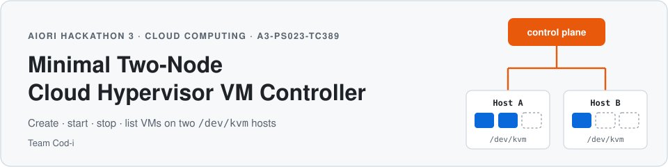
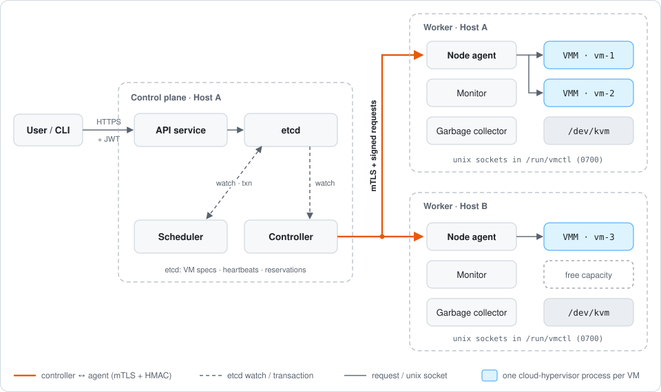
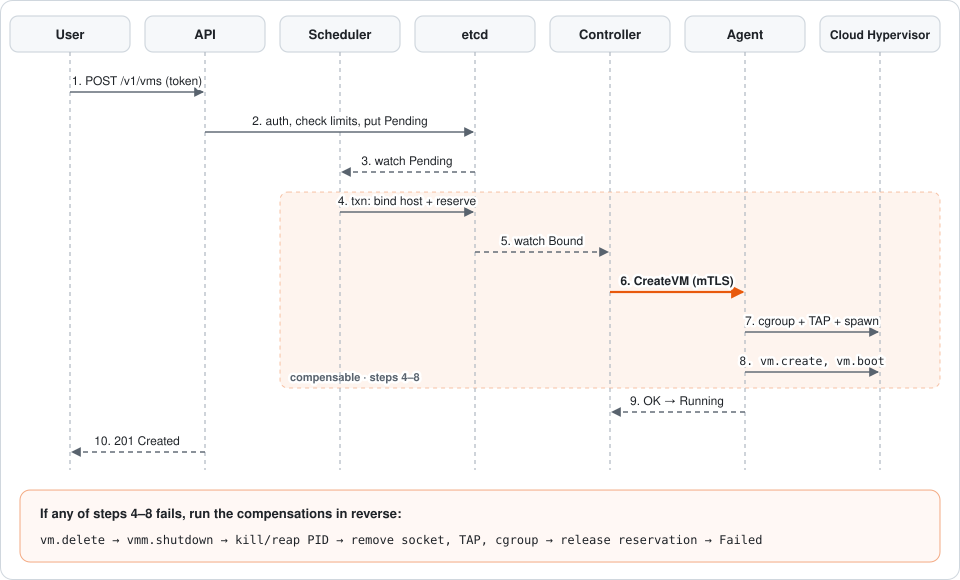
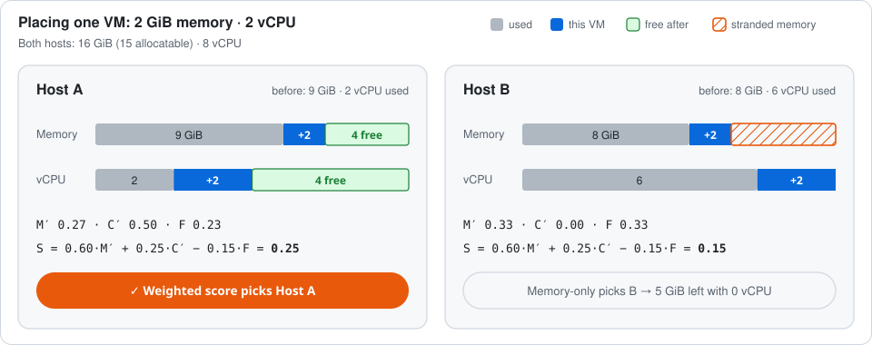
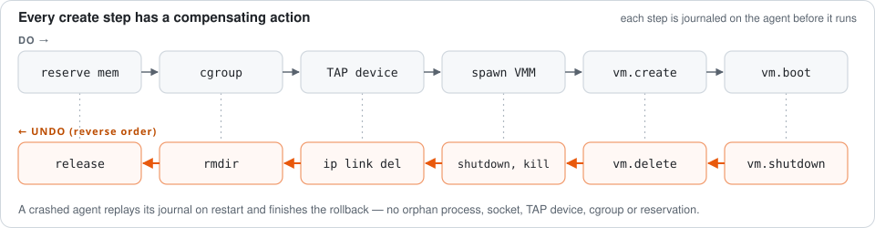
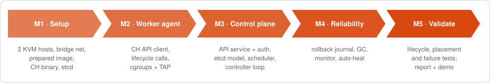

Youtube Link :- https://youtu.be/L1Gjc_y92pE

<p align="center">
  
</p>

<p align="center">
  
  
  
  
  
</p>

<p align="center">
  A small controller and two worker agents that <b>create, start, stop and list VMs</b> on two <code>/dev/kvm</code> hosts
  through the <a href="https://github.com/cloud-hypervisor/cloud-hypervisor/blob/main/docs/api.md">Cloud Hypervisor REST API</a>.
  It is a Kubernetes-style control plane, cut down to what two hosts need.
</p>

> [!NOTE]
> This repository currently holds the **design proposal** ([`aiori-ps023.pdf`](aiori-ps023.pdf)). The implementation follows the [milestones](#-deployment-timeline) below.

---

## Contents

- [Problem](#-problem)
- [Background: KVM + Cloud Hypervisor](#-background-kvm--cloud-hypervisor)
- [Architecture](#-architecture)
- [Create-VM data flow](#-create-vm-data-flow)
- [Placement: filter, then a weighted score](#-placement-filter-then-a-weighted-score)
- [Failure handling and clean-up](#-failure-handling-and-clean-up)
- [Resource limits and authentication](#-resource-limits-and-authentication)
- [Baseline vs. our design](#-baseline-vs-our-design)
- [Test plan](#-test-plan)
- [Deployment timeline](#-deployment-timeline)
- [Literature and RFCs](#-literature-and-rfcs)
- [Team](#-team)

---

## 🎯 Problem

Enterprise hypervisor stacks such as OpenStack and libvirt run many daemons, databases and queues. That's too heavy for a two-host edge site. We need the smallest controller that still handles the hard parts correctly:

| Challenge | What can go wrong |
|---|---|
| **Placement** | Choosing a host by free memory alone can over-commit it or leave capacity stranded. |
| **Security** | An open control channel amounts to remote code execution on the host. |
| **Limits** | One VM must never starve the host or the VMs next to it. |
| **Leaks** | A failed API call can leave orphan VMM processes, sockets, TAP devices and pinned memory behind. |
| **Crashes** | A dead VM must be detected and healed, not silently forgotten. |

**Out of scope (per the problem statement):** live migration, distributed storage, browser VNC, an image marketplace, and writing a new hypervisor.

---

## 📚 Background: KVM + Cloud Hypervisor

**KVM** turns Linux into a type-1 hypervisor: `/dev/kvm` exposes CPU virtualisation to user space. **Cloud Hypervisor** is a Rust VMM that runs on KVM and supports only modern virtio devices, which keeps its attack surface small and boot times short.

Each VM is one `cloud-hypervisor` process, started with `--api-socket` and controlled with HTTP/JSON over that Unix socket. Cloud Hypervisor has **no daemon of its own**, so something has to own the process lifecycle. In this design, that owner is our node agent.

| Our operation | Cloud Hypervisor calls (under `/api/v1/` on the per-VM socket) |
|---|---|
| `create` | spawn VMM → `PUT vm.create` |
| `start`  | `PUT vm.boot` |
| `stop`   | `PUT vm.shutdown` |
| `list`   | `GET vm.info`, `GET vmm.ping` |
| `delete` | `PUT vm.delete` → `PUT vmm.shutdown` → reap PID |

---

## 🏗 Architecture

<p align="center">
  
</p>

<table>
<tr><th width="50%">Control plane (runs on Host A)</th><th>Worker plane (Host A and Host B)</th></tr>
<tr valign="top"><td>

- **API service**: the user-facing REST endpoint. Handles authentication, input validation and limit admission.
- **Scheduler**: it picks a host for each pending VM (filter, then weighted score).
- **Controller**: a reconcile loop that compares desired state with actual state and drives create/stop, rollback and auto-heal.
- **etcd**: the persistent store for VM specs, node heartbeats and memory reservations.

</td><td>

- **Node agent** (kubelet-style): accepts signed requests from the controller and calls the Cloud Hypervisor API.
- **Monitor**: a separate process that watches VMM PIDs, polls `vmm.ping` / `vm.info`, and reports health.
- **Garbage collector**: kills orphan VMMs and frees their memory, sockets, TAP devices and cgroups.
- **Proxy**: VM service networking *(future scope)*.

</td></tr>
</table>

### User API

| Method | Path | Action |
|---|---|---|
| `POST`   | `/v1/vms`              | Create a VM |
| `POST`   | `/v1/vms/{id}/start`   | Start a VM |
| `POST`   | `/v1/vms/{id}/stop`    | Stop a VM |
| `GET`    | `/v1/vms`              | List VMs |
| `DELETE` | `/v1/vms/{id}`         | Delete a VM |

Stop and delete are idempotent: repeating them returns no error. Error responses use standard HTTP status codes (RFC 9110).

---

## 🔁 Create-VM data flow

<p align="center">
  
</p>

Start, stop and delete follow the same **controller → agent → VMM** path.

---

## ⚖️ Placement: filter, then a weighted score

**1. Filter.** A host is dropped if:
- its heartbeat is older than **10 s** (NotReady);
- `free memory − host reserve < VM memory + VMM overhead`; or
- `free vCPU < requested vCPU`.

**2. Score the remaining hosts** (memory weighted most heavily, per the problem statement):

$$S = 0.60\,M' + 0.25\,C' - 0.15\,F$$

| Term | Meaning |
|---|---|
| $M'$ | free memory after placement ÷ allocatable memory |
| $C'$ | free vCPU after placement ÷ allocatable vCPU |
| $F = \lvert M' - C' \rvert$ | imbalance: capacity left stranded |

**3. Commit.** The memory reservation is written in an **etcd transaction** that compares the revision, so two concurrent requests cannot double-book a host.

### Worked example

<p align="center">
  
</p>

| | Host A | Host B |
|---|---|---|
| Used before | 9 GiB / 2 vCPU | 8 GiB / 6 vCPU |
| Free after  | 4 GiB / 4 vCPU | 5 GiB / 0 vCPU |
| $M'$, $C'$, $F$ | 0.27, 0.50, 0.23 | 0.33, 0.00, 0.33 |
| Memory-only | — | **picked** |
| Weighted $S$ | **0.25 ✓ picked** | 0.15 |

Memory-only placement sends the VM to Host B and leaves 5 GiB stranded with no vCPU free to use it. The weighted score sends it to Host A and keeps both hosts usable.

---

## 🛟 Failure handling and clean-up

> **No VM process outlives its record; no record outlives its VM.**

<p align="center">
  
</p>

<table>
<tr><th>Transactional rollback</th><th>Garbage collector</th><th>Monitor + auto-heal</th></tr>
<tr valign="top">
<td>

Every multi-step operation is a **saga**: each step has a compensating action. Each step is journaled on the agent **before** it runs, so a crashed agent finishes the rollback when it restarts.

</td>
<td>

Runs **every 30 s** and on agent start. It lists VMM PIDs in the agent's cgroup slice and sockets in `/run/vmctl`, and compares them with etcd.

For an orphan: `vmm.shutdown` → `SIGTERM` → `SIGKILL` → reap → free memory, socket, TAP and cgroup.

**Fail-safe:** if the controller is unreachable, the GC kills nothing.

</td>
<td>

The monitor learns of a VMM exit immediately through **pidfd**, and it also polls `vmm.ping` / `vm.info` every **5 s**.

If the desired state is Running and the VM is dead, the controller restarts it on the same host with backoff (1, 2, 4 s, …).

If a host stays NotReady for **more than 30 s**, its VMs are cold-booted on the other host from the prepared image. This is not live migration. A **generation number** ensures the stale copy is reaped when the old host rejoins.

</td>
</tr>
</table>

---

## 🔐 Resource limits and authentication

<table>
<tr><th width="50%">Resource-limit enforcement</th><th>Authenticated API</th></tr>
<tr valign="top"><td>

**Admission (API):** 1–4 vCPU and 256 MiB–4 GiB per VM (configurable), plus a maximum number of VMs per host.

**Host reserve:** 1 GiB is kept for the host OS. Memory is never over-committed.

**Runtime (agent):** one cgroup v2 group per VM:

```text
memory.max      = guest + VMM overhead
memory.swap.max = 0
cpu.max         = vCPU × period
pids.max        = caps thread count
```

**Double check:** before spawning, the agent re-reads `MemAvailable` and refuses the request if the scheduler's view was stale.

</td><td>

**User → API:** HTTPS (TLS 1.3) with a short-lived JWT that carries a role and an expiry.

**Controller ↔ agent:** mutual TLS with a private CA, one certificate per host. Each request also carries an **HMAC-SHA256** signature over the method, path, body, timestamp and nonce.

A request with a wrong certificate, clock skew over 30 s, or a replayed nonce gets `401`.

**Agent → VMM:** Unix sockets in a `0700` directory owned by the agent. They are never exposed on the network.

The agent listens **only on the management interface**.

</td></tr>
</table>

---

## 📊 Baseline vs. our design

| Aspect | Naive controller | Our design |
|---|---|---|
| Footprint | Many daemons + SQL DB + message queue | One controller binary + etcd; one agent + monitor per host |
| Placement | First-fit or most-free-memory | Filter + weighted score (memory, vCPU, fragmentation) |
| Concurrency | Races can double-book memory | Reservation committed in an etcd transaction |
| Failure mid-create | Orphan process, socket, TAP device | Saga rollback: every step has a compensating action |
| VM crash | Stays dead; state goes stale | Monitor detects it; controller restarts it with backoff |
| Leaked resources | Manual clean-up | Periodic GC + reconcile on agent start |
| Control channel | Open HTTP / shared Unix socket | mTLS + signed, short-lived requests; sockets never on the network |

---

## 🧪 Test plan

| Lifecycle | Two-host placement | Failure injection |
|---|---|---|
| create → start → list → stop → start → delete; check `vm.info` state after each step | Fill Host A → the next VM lands on Host B | `kill -9` a VMM → auto-heal |
| Repeat stop/delete: idempotent, no error | Replay the worked example: weighted score picks A, memory-only picks B | Kill the agent mid-create → rollback on restart |
| Reject out-of-limit requests at admission | 10 concurrent creates: no over-reservation | Cut Host B's network → NotReady → reschedule |
| | Nothing fits → clear error, no partial state | Bad certificate / replayed request → `401` |

> **Leak check after every test:** no stray `cloud-hypervisor` PIDs, sockets, TAP devices or cgroups, and `MemAvailable` returns to its baseline.

---

## 🗺 Deployment timeline

<p align="center">
  
</p>

**Method:** we build bottom-up. The agent works against Cloud Hypervisor on its own before the controller exists, and each milestone ends with its tests passing on both hosts.

**Future scope:** a proxy for VM service networking, a 3-node etcd cluster for controller HA, Prometheus metrics, and support for more than two hosts.

---

## 📖 Literature and RFCs

| Source | What we take from it |
|---|---|
| Cloud Hypervisor API [1] | VM config schema, lifecycle endpoints, per-VM API socket |
| Kubernetes architecture & scheduler [2, 3] | Declarative state + reconcile loop; node agent; filter → score scheduling; balanced-allocation scoring |
| etcd / Raft [4] | Consistent store with transactions (compare-and-swap), watches and leases |
| Firecracker, NSDI '20 [5] | One process per microVM, cgroup confinement, minimal device model |
| Sagas, SIGMOD '87 [6] | Multi-step operation = steps + compensating actions → transactional rollback |
| RFC 8446, RFC 7519, RFC 2104 [7–9] | Mutual TLS between controller and agents; signed, short-lived tokens |
| RFC 9110 [10] | Idempotent PUT/DELETE, status codes for API errors |
| Linux cgroup v2 [11] | `memory.max`, `cpu.max`, `pids.max` for hard per-VM limits |

<details>
<summary><b>Bibliography</b></summary>

1. Cloud Hypervisor Project. *Cloud Hypervisor API.* [github.com/cloud-hypervisor/cloud-hypervisor/blob/main/docs/api.md](https://github.com/cloud-hypervisor/cloud-hypervisor/blob/main/docs/api.md)
2. The Kubernetes Authors. *Kubernetes Components.* [kubernetes.io/docs/concepts/overview/components](https://kubernetes.io/docs/concepts/overview/components/)
3. The Kubernetes Authors. *Scheduling Framework and Resource Bin Packing.* [kubernetes.io/docs/concepts/scheduling-eviction](https://kubernetes.io/docs/concepts/scheduling-eviction/)
4. D. Ongaro, J. Ousterhout. "In Search of an Understandable Consensus Algorithm." USENIX ATC, 2014; and etcd documentation, [etcd.io/docs](https://etcd.io/docs/)
5. A. Agache et al. "Firecracker: Lightweight Virtualization for Serverless Applications." USENIX NSDI, 2020.
6. H. Garcia-Molina, K. Salem. "Sagas." ACM SIGMOD, 1987.
7. E. Rescorla. *The Transport Layer Security (TLS) Protocol Version 1.3.* RFC 8446, 2018.
8. M. Jones, J. Bradley, N. Sakimura. *JSON Web Token (JWT).* RFC 7519, 2015.
9. H. Krawczyk, M. Bellare, R. Canetti. *HMAC: Keyed-Hashing for Message Authentication.* RFC 2104, 1997.
10. R. Fielding, M. Nottingham, J. Reschke. *HTTP Semantics.* RFC 9110, 2022.
11. T. Heo. *Control Group v2.* Linux kernel documentation, [docs.kernel.org/admin-guide/cgroup-v2.html](https://docs.kernel.org/admin-guide/cgroup-v2.html)
12. A. Kivity et al. "kvm: the Linux Virtual Machine Monitor." Ottawa Linux Symposium, 2007.

</details>

---

## 👥 Team

**Team Cod-i** · AIORI Hackathon 3 · `A3-PS023-TC389`

| Dr Om Prakash Singh | Harsh Kharwar | Yug Sharma |
|:---:|:---:|:---:|

📄 Full proposal: [`aiori-ps023.pdf`](aiori-ps023.pdf)
